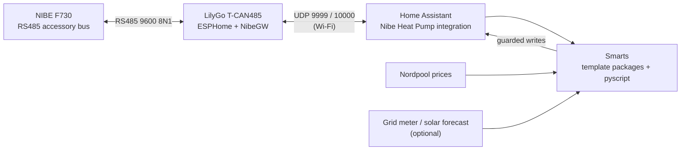

# nibegw-ha-smarts

Local, cloud-free control of a **NIBE** heat pump from **Home Assistant**, using a
~€20 **LilyGo T-CAN485** ESP32 board as an RS485 gateway — plus a set of "smarts"
that steer the pump by **electricity price**, **indoor temperature**, **solar surplus**
and **airflow**.

No myUplink, no cloud account, no MQTT bridge, no Raspberry Pi / SD card.

Built and running on a **NIBE F730** (exhaust-air heat pump) in Sweden (Nordpool SE4).
It replaces [NibePi](https://github.com/anerdins/node-red-contrib-nibepi) and
re-implements its most useful plugins natively in Home Assistant.



## What you get

| Feature | What it does | Default |
|---|---|---|
| **Indoor compensation** | Shifts the heat curve by `(setpoint − room) × factor`, clamped ±10 °C | on |
| **Overshoot protection** | Blocks heating above an outdoor temp, stops heat and resets degree minutes when the room overshoots | on |
| **Price control** | NibePi's spot-price arbitrage classifier → heat offset + hot-water mode per price level | on |
| **Fan regulation** | Steers fan % so the measured airflow (BS1) hits a target; low / degree-minute / CO₂ boost modes | on |
| **Frequency regulation** | At high price, caps the compressor's max frequency on an outdoor-temp curve; can block the immersion heater | off |
| **Hot water** | Auto-luxury on a big draw, hot-water priority | off |
| **Solar surplus** | Stores exported PV as heat (hot water to Luxury + a capped space-heat boost), gated by forecast and price, legionella-safe | off |
| **Dashboards** | Lovelace dashboard (Home + Advanced) and a Grafana dashboard | — |

Everything writes through **one master switch**, `input_boolean.nibe_write_enable`,
which starts **off**. With it off, all features compute and show what they *would*
do, but nothing is sent to the pump. Hot water has a second switch
(`nibe_hw_write_enable`, also off) — see [Lessons learned](docs/smarts.md#lessons-learned).

## Requirements

**Hardware**
- A NIBE heat pump with an RS485 accessory/MODBUS40 port that works with
  [NibeGW](https://github.com/elupus/esphome-nibe) (F-series such as F730/F750/F1155/F1255,
  S-series, SMO …). Developed on an **F730**; other models work but some entity names differ.
- [LilyGo T-CAN485](https://github.com/Xinyuan-LilyGO/T-CAN485) (ESP32 + MAX13487 RS485)
- 4 wires and one jumper — see [docs/hardware.md](docs/hardware.md)

**Home Assistant**
- Core **Nibe Heat Pump** integration (`nibe_heatpump`, connection type *NibeGW*)
- [pyscript](https://github.com/custom-components/pyscript) (HACS)
- [Nordpool](https://github.com/custom-components/nordpool) (HACS) — needs the
  `raw_today` / `raw_tomorrow` attributes
- Optional: a net grid-power sensor (P1/HAN reader) + [Forecast.Solar](https://www.home-assistant.io/integrations/forecast_solar/)
  for the solar feature; a CO₂ sensor for fan CO₂ boost
- Dashboard cards (HACS): [Mushroom](https://github.com/piitaya/lovelace-mushroom),
  [button-card](https://github.com/custom-cards/button-card),
  [apexcharts-card](https://github.com/RomRider/apexcharts-card)
- Optional: Prometheus + Grafana for the Grafana dashboard

## Quick start

1. **Build the gateway** — wire and flash the T-CAN485 ([docs/hardware.md](docs/hardware.md)).
2. **Add the integration** — *Settings → Devices & services → Add → Nibe Heat Pump →
   NibeGW*, with the gateway's IP, your model, ports `9999`/`10000`.
3. **Enable the entities the smarts use** — most pump entities start disabled; enable
   the ones listed in [docs/entities.md](docs/entities.md).
4. **Install the packages and scripts** — enable packages in `configuration.yaml`:
   ```yaml
   homeassistant:
     packages: !include_dir_named packages
   ```
   Copy `homeassistant/packages/*.yaml` → `/config/packages/` and
   `homeassistant/pyscript/*.py` → `/config/pyscript/` (pyscript's default settings
   are enough).
5. **Edit `nibe_site.yaml`** — point the room temperature, Nordpool, grid power,
   solar forecast and CO₂ aliases at your own sensors. This is the only file you
   have to change.
6. Restart HA, then add the dashboard from
   [`homeassistant/dashboards/nibe-dashboard.yaml`](homeassistant/dashboards/nibe-dashboard.yaml)
   (create a dashboard with URL `dashboard-nibe`, open the raw configuration editor, paste).
7. **Watch first.** Leave *Write to pump* off for a day and check that the offsets
   and modes look sane. Then switch it on.

> **Tuning lives in YAML.** The packages use `initial:` so the repo is the source of
> truth: values you change on the dashboard reset to the package defaults on restart.
> To change a value for good, edit the package. The defaults are the author's F730 tuning.

## Repository layout

```
esphome/                  ESPHome config for the T-CAN485 gateway (+ secrets example)
homeassistant/
  packages/nibe_site.yaml   ← your sensor mapping (edit this)
  packages/nibe_*.yaml      helpers, template sensors, write automations
  pyscript/nibe_*.py        price / fan / frequency / hot water / solar logic
  dashboards/               Lovelace dashboard
grafana/                  Grafana dashboard (Prometheus datasource)
tools/                    stand-alone price classifier CLI + tests
docs/                     hardware, entities, how the smarts work, NibePi migration
```

## Docs

- [Hardware: wiring, the RS485 ground fix, flashing](docs/hardware.md)
- [Entities the smarts use](docs/entities.md)
- [How the smarts work (and lessons learned)](docs/smarts.md)
- [Migrating from NibePi](docs/migrating-from-nibepi.md)

## Disclaimer

This writes to your heat pump's control registers. It's been running on the author's
F730 since August 2026, but your pump, model and firmware may behave differently. Use
the write switch, watch the results, and keep an eye on the pump's alarm log. No
warranty — see [LICENSE](LICENSE).

## Credits

- [elupus](https://github.com/elupus) — [esphome-nibe](https://github.com/elupus/esphome-nibe)
  (NibeGW firmware), the `nibe` Python library and the Home Assistant integration.
- [Fredrik Anerdin](https://github.com/anerdins) — NibePi and
  [node-red-contrib-nibepi](https://github.com/anerdins/node-red-contrib-nibepi) (MIT),
  whose price, indoor, fan, frequency and hot-water logic is ported here.

## License

[MIT](LICENSE)
