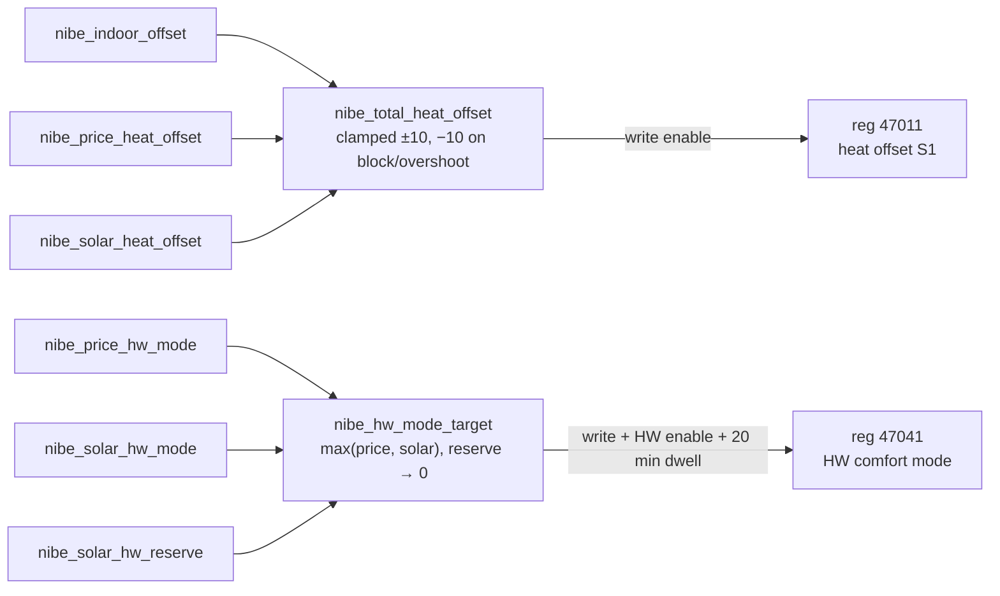

# How the smarts work

All features follow the same pattern: **helpers** (on/off switches and tuning values) live
in a package, the **logic** is a template sensor or a pyscript module that only
*publishes sensors*, and the **write package** is the one place that pushes values into
the pump — and only while `input_boolean.nibe_write_enable` is on.

The fan, frequency and hot-water-lux modules write their own registers (fan %, max
compressor frequency, temporary lux), each behind the same master switch.

## Indoor compensation — `nibe_indoor.yaml`

`offset = (setpoint − room) × factor`, clamped to ±10 °C. With factor 2.6, a room 1 °C
too warm lowers the curve by 2.6. Use a room temperature that represents the house — a
mean of several rooms works far better than one sensor.

Overshoot protection:
- **Outdoor block** — outdoor ≥ 15 °C → offset −10 (no space heating in summer).
- **Stop heat** — room ≥ setpoint + 1 °C → offset −10.
- **Degree-minute reset** — room ≥ setpoint + 1 °C and DM < 0 → write DM = 1, so the
  compressor stops chasing heat demand it built up earlier.

## Price control — `nibe_price.yaml` + `pyscript/nibe_price.py`

A port of NibePi's "Lokal AI" — not machine learning but a price-arbitrage classifier:

1. Take today's + tomorrow's prices (hourly, in öre).
2. Find every cheap→expensive pair within the look-ahead window (12 h) whose spread
   beats `min_spread` (35 öre), and pick the most profitable set of non-overlapping pairs.
3. Split the buy hours by median into **VERY_CHEAP / CHEAP**, the sell hours into
   **EXPENSIVE / VERY_EXPENSIVE**; everything else is **NORMAL**.
4. Map the current hour's level to a heat offset (+2/+1/0/−2/−4 °C) and a hot-water
   comfort mode.

**Indoor guard:** an expensive-hour cut is skipped when the room is already more than
1.5 °C below the setpoint.

`tools/price_optimizer.py` is the same classifier as a stand-alone CLI with tests
(`python3 tools/price_optimizer.py --area SE3`, fetches Swedish prices from
elprisetjustnu.se) — handy for tuning without HA.

## Fan regulation — `nibe_fan.yaml` + `pyscript/nibe_fan.py`

Every minute, nudges the exhaust fan % (register 47265) towards a target airflow measured
by BS1: ±5 % when more than 20 m³/h off, ±1 % when 10–20 off. Target by mode (later wins):

| Mode | When | Default target |
|---|---|---|
| normal | always | 202 m³/h |
| low | compressor below 41 Hz | 180 m³/h |
| DM boost | degree minutes below −300 | 250 m³/h |
| CO₂ boost | CO₂ above 1000 ppm | 300 m³/h |

Pauses during defrost (alarm 183) or when the evaporator is ≤ 0 °C.

## Frequency regulation — `nibe_freq.yaml` + `pyscript/nibe_freq.py` (off by default)

At or above a price level, caps the compressor's **max frequency** on an outdoor-temp curve
(linear between two points) instead of only lowering the curve, and can block the immersion
heater. Restores the normal max (120 Hz) when the price drops.

## Hot water — `nibe_hotwater.yaml` + `pyscript/nibe_hotwater.py` (off by default)

- **Auto-lux:** BT6 drops by ≥ X °C within Y minutes (a shower/bath) → *one-time increase*.
- **Priority:** BT7 below a start temperature → *one-time increase* until it's back above
  the stop temperature.

## Solar surplus — `nibe_solar.yaml` + `pyscript/nibe_solar.py` (off by default)

Uses net grid power (negative = exporting). When you're exporting, it stores the surplus
as heat instead:

- **Hot water → Luxury** (the tank is a free thermal battery), but only while BT7 is below
  50 °C — see lessons learned.
- **Space heat +4 °C**, stopped once the room is 1 °C above setpoint.

Guards, in order:
- **Hysteresis:** on above 1.0 kW export, off below 0.3 kW, with a 45-min release delay so
  passing clouds don't make it flap.
- **Forecast gate:** only while the solar forecast still expects ≥ 2 kWh today. When the
  day's sun is done it releases right away.
- **Price gate:** at EXPENSIVE+ levels, or when the spot price is above a threshold, it
  stands down and lets the surplus be **sold**. Storing pays off when buying back later costs
  more than exporting earns now (energy tax + grid fee + VAT apply to import only). Without
  any export subsidy, the break-even in SE4 was about 1.8 SEK/kWh.
- **Morning reserve (optional):** on a sunny-forecast morning (05–12, ≥ 8 kWh ahead), asks for
  **Economy** hot water so the tank still has room when the surplus arrives instead of being
  filled with grid power.
- **Legionella-safe:** comfort mode doesn't gate the pump's periodic increase, and the
  reserve stands down during a detected legionella run (BT7 ≥ 60 °C) or when the tank is
  cold (BT7 ≤ 40 °C).

The payoff is mostly spring/autumn (surplus *and* heat demand); in summer only hot water
can absorb it.

## Lessons learned

**Don't push hot-water modes on a hot tank.** With solar and price both requesting
Luxury, the F730 did eight 3–5 minute compressor runs in a day, each about 20 minutes
apart, and raised a *short operating times* alarm. The pump kept trying to reach the
Luxury top-end, tripped its envelope, waited out its minimum off-time and tried again.
Fixes in this repo:
- `nibe_hw_write_enable` (default **off**): the smarts don't touch hot water at all
  unless you opt in. With it off, the pump did 13–18 hot-water charges a day of 9–64
  minutes each, none shorter than 7 minutes.
- Solar stops asking for Luxury once BT7 ≥ 50 °C.
- At least 20 minutes between HW-mode changes.

**Watch first, then write.** Leave `nibe_write_enable` off for a day and compare the
published offsets with what you'd expect. The Grafana dashboard's "how the heat-curve
offset is built" panel is made for that.

**pyscript gotchas:** no generator expressions (use list comprehensions); wrap every
`state.get()` in `try/except` (a missing or brand-new entity raises a `NameError`); Nordpool
`raw_*` timestamps arrive as `datetime` objects, not strings.

## Grafana

`grafana/nibe-dashboard.json` expects HA's
[Prometheus integration](https://www.home-assistant.io/integrations/prometheus/) scraped by
Prometheus. On import, pick your Prometheus datasource for `DS_PROMETHEUS`.
